<div align="center">
  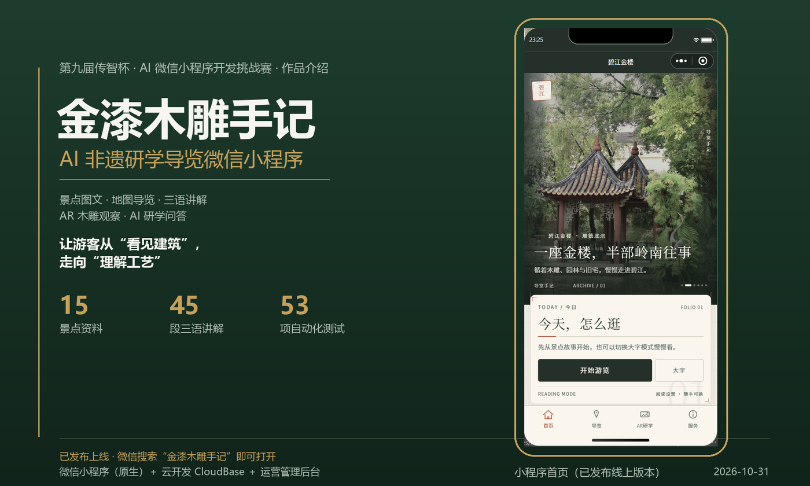
</div>

# 金漆木雕手记 · AI 非遗研学导览微信小程序

> 一个小程序，把「看建筑」变成「做观察」。面向岭南传统建筑参观场景，把景区导览、三语讲解、AR 木雕观察与有来源的 AI 研学问答放进同一条动线。

**已通过审核并正式发布上线，微信搜索「金漆木雕手记」即可打开。**

参赛方向：第九届传智杯 · AI 微信小程序开发挑战赛（AI 赋能文旅服务）

形态：原生微信小程序 ＋ 微信云开发 CloudBase ＋ 运营管理后台

---

## 这个作品解决什么问题

游客走进碧江金楼，能看到精美的金漆木雕，却常常不知道**该看哪里、怎么看**。景区图文通常只是"读完一段介绍"，看完就忘；长者看不清小字，外地和外国游客听不懂方言讲解，行前也不知道要逛多久、怎么去。

本作品把一次参观拆成四件事，让小程序真正跟着游客走：

| 阶段 | 小程序做什么 |
|---|---|
| 去之前 | 看有哪些景点、要逛多久、怎么到、门票怎么买 |
| 到了 | 打开景区导览图找点位，边走边听讲解 |
| 看到木雕 | 用 AR 木雕寻宝把"看"变成"找线索、答题、拿徽章" |
| 看不明白 | 直接问 AI，回答带资料或网页来源；没依据就说没依据 |

## 亮点

1. **已在微信正式上线，搜索「金漆木雕手记」即可打开。** 已完成备案、代码审核并正式发布，任何人都能直接进入体验。
2. **内容是真的：现场实拍 ＋ 与景区合作取得的地图与路线。** 项目组已与景区建立合作，导览图与三条推荐路线由景区工作人员提供；景点照片全部现场拍摄，不是网上拼的示意图。
3. **把"看建筑"变成"做观察"。** 确认目标 → 三枚线索 → 一道小题 → 观察员徽章，把被动阅读变成主动观察。
4. **AI 回答有依据，资料不足会明说。** 先检索已整理资料，模型只在证据范围内组织语言；命中不足时明确提示"资料库暂未收录"，不编造票价、开放时间或工艺结论。
5. **资料不足时才联网，且回答带来源。** 只在本地资料撑不住时触发**一次**联网检索，逐条列出网页来源，并提示搜索结果可能不完整或较旧。
6. **三语讲解 ＋ 大字模式。** 普通话、粤语、英语 45 段；全站可一键放大字号，照顾长者。
7. **服务页可运营。** 预留商家与周边推荐位，景区可把附近景点、酒店、美食与商铺的链接接进来，形成可收费的展示与导流位。
8. **购票走官方跳转，不在小程序内收款。** 复制或跳转景区官方购票入口，资金与票据留在官方平台——既守住边界，也回避个人主体接入在线支付的审核难点。
9. **如实标注能力边界。** AR 是"相机对准确认 ＋ 热点交互"，问答是关键词检索而非向量库，到现场即可验证，不包装。

## 界面一览

<table>
<tr>
<td width="300">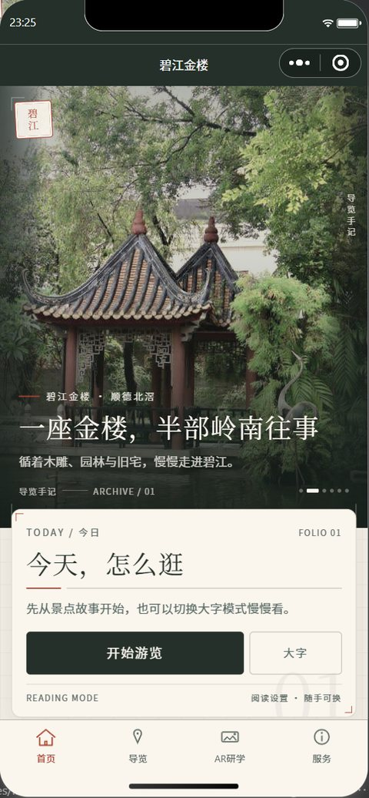</td>
<td>

**首页 · 一次进门就说清"今天怎么逛"**

- 6 张现场实拍轮播，第 1 张即首图，后台可随时更换
- 三个入口对应三条动线：AR 木雕寻宝 / 常见问题（AI 问答）/ 我的游览
- "开始游览"进入景点列表，右上"大字"一键切换长者阅读模式

</td>
</tr>
<tr>
<td>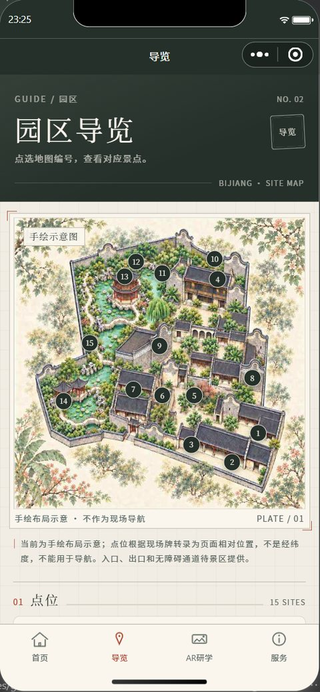</td>
<td>

**导览 · 景区导览图与编号点位**

- 使用景区实际导览图，编号点位与现场景点一一对应
- 点编号弹出景点卡片，一键进入详情，不必先翻长列表
- 选择游线后由 Canvas 绘出路线，并显示当前站点与进度

</td>
</tr>
<tr>
<td>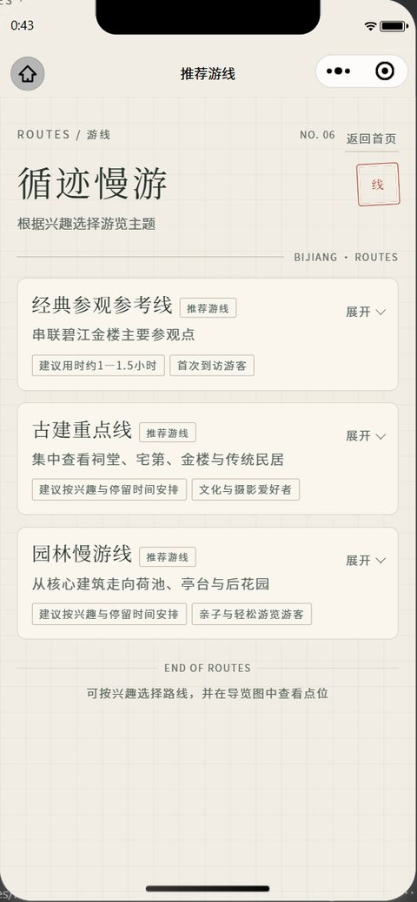</td>
<td>

**推荐游线 · 景区提供的三条主题路线**

- 经典参观参考线、古建重点线、园林慢游线，均为向景区申请取得的实际路线
- 每条标注建议用时与适配人群
- 路线只做参考，不宣称实时导航或最优路径计算

</td>
</tr>
<tr>
<td>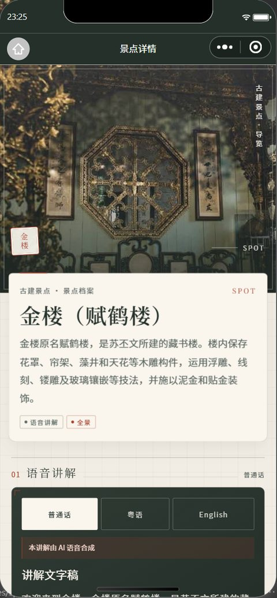</td>
<td>

**景点详情 · 实拍封面、三语讲解与文字稿**

- 封面为现场实拍，正文为对照公开资料核对后的介绍
- 讲解支持普通话 / 粤语 / 英语，并如实标注"本讲解由 AI 语音合成"
- 保留讲解文字稿，弱网或静音场景仍可阅读

</td>
</tr>
<tr>
<td>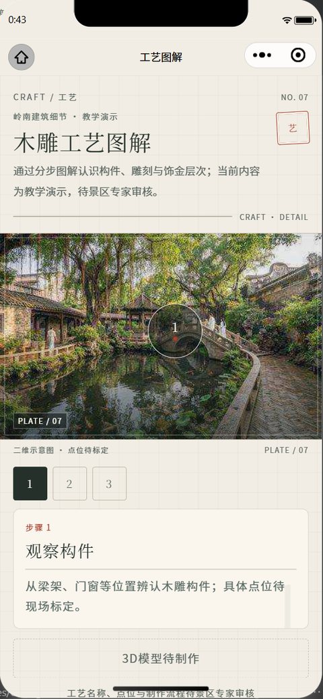</td>
<td>

**工艺图解 · 木雕工序分步说明**

- 把木雕从选料到饰金的工序拆成编号步骤，与 AR 观察线索互相呼应
- 用于回答"这块木雕为什么好看"，把工艺知识变成可读的步骤
- 后续可接入更多构件的图解，仍沿用同一套编号结构

</td>
</tr>
<tr>
<td>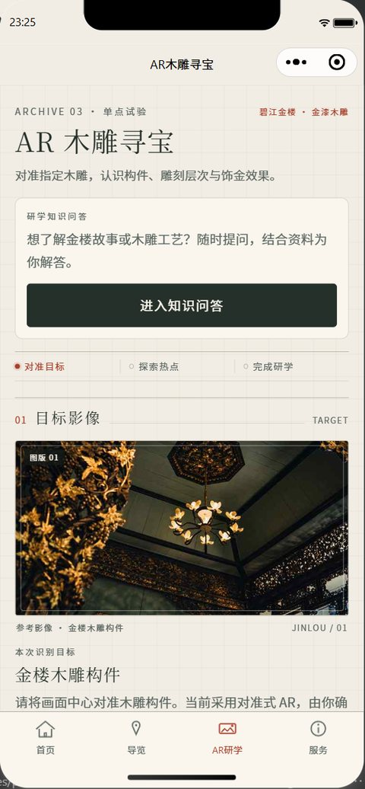</td>
<td>

**AR 研学入口 · 先讲清目标和准备动作**

- 进入前先说清识别目标、三步准备与安全距离，降低现场误操作
- 提供不必先玩 AR 的"进入知识问答"入口
- 相机不可用时提示切换参考图模式，热点与问答流程完全一致

</td>
</tr>
<tr>
<td>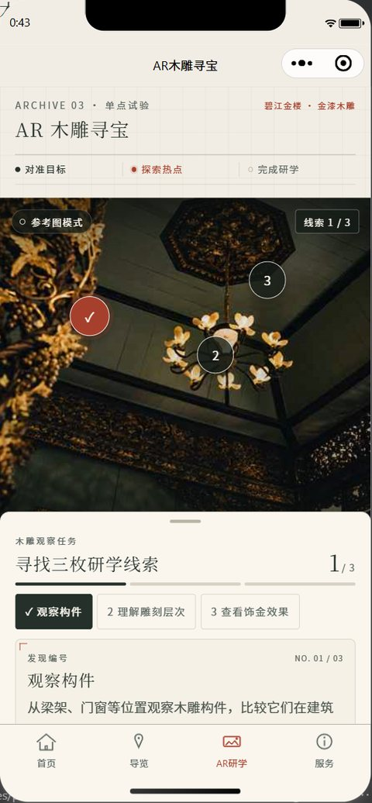</td>
<td>

**AR 木雕寻宝 · 三枚线索叠加在真实画面上**

- 三枚编号热点叠在木雕实拍上，已访问打勾，右上显示"线索 1/3"
- 集齐三枚才解锁研学问答彩蛋，答对获得"小小木雕观察员"
- 界面如实显示"参考图模式"，相机不可用时流程一致

</td>
</tr>
<tr>
<td>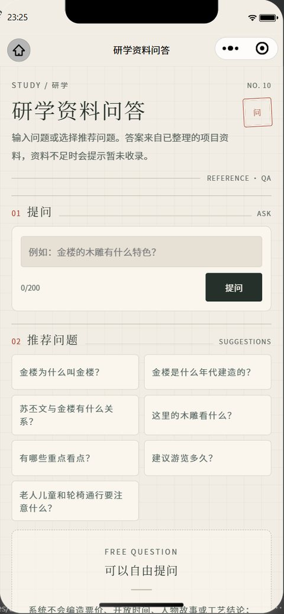</td>
<td>

**AI 研学问答 · 答案、回答方式与来源**

- 可自由输入，也可点推荐问题，最多 200 字
- 回答上方标注"回答方式"，下方可展开资料或网页来源并复制链接
- 资料库没有内容时明确提示暂未收录，不编造答案

</td>
</tr>
<tr>
<td>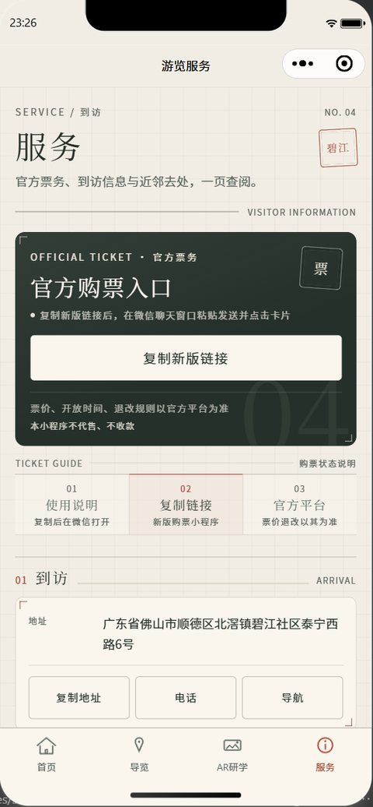</td>
<td>

**服务页 · 到访信息、周边推荐与官方购票**

- 地址、电话、开放时间、导览图与一键导航
- 周边推荐位可上架附近景点、酒店、美食与商铺，是景区可运营的展示与导流位
- "官方购票入口"跳转或复制官方链接，不在小程序内收款、不开票

</td>
</tr>
<tr>
<td>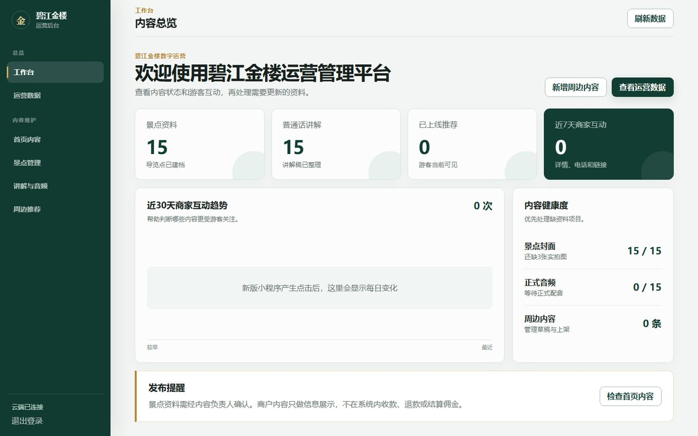</td>
<td>

**运营后台 · 工作台**

- 一眼看到景点数、讲解数、已上线推荐数与内容健康度
- "发布提醒"把内容责任、商户只做信息展示等边界写在运营界面里
- 运营数据来自真实小程序点击事件，不是手工填的数字

</td>
</tr>
<tr>
<td>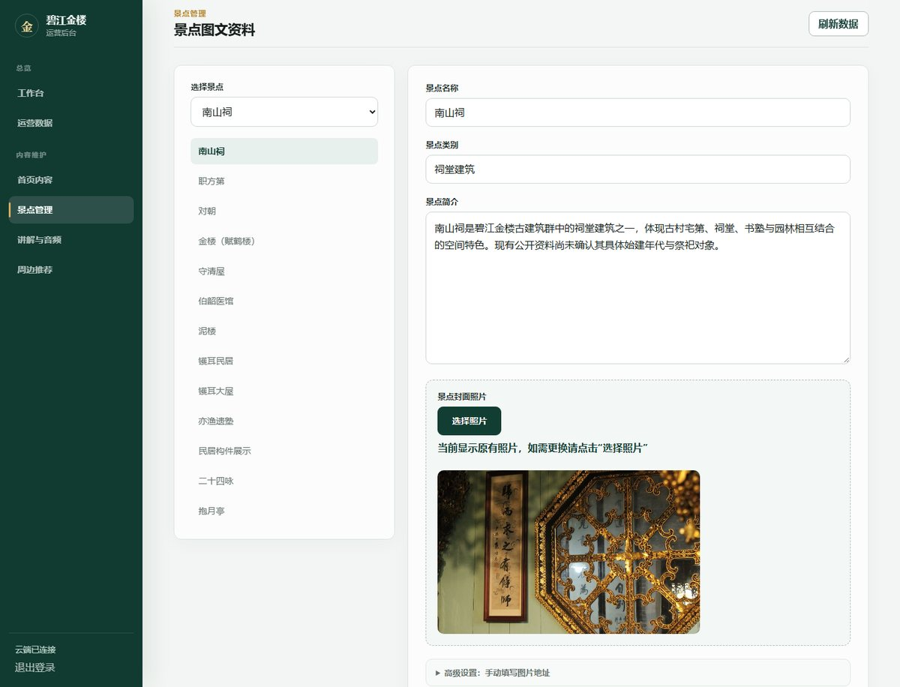</td>
<td>

**运营后台 · 景点管理**

- 选景点后直接改名称、类别、简介，保存即影响小程序
- 封面可换图，并可恢复上一张，避免选错图无法回退
- 修改前自动备份，运营人员可独立完成维护

</td>
</tr>
<tr>
<td>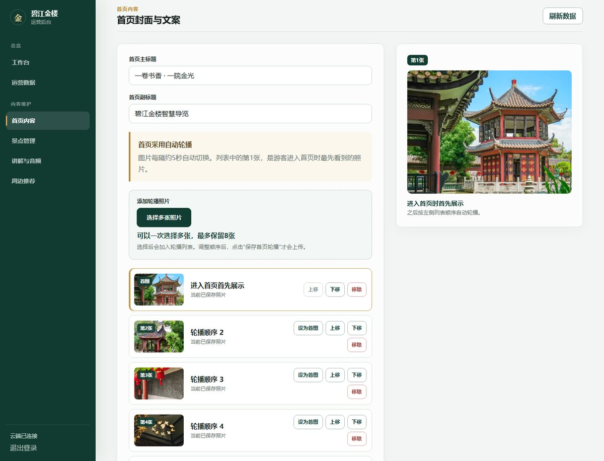</td>
<td>

**运营后台 · 首页内容**

- 首页主标题、副标题可直接改，解决"改一行字要重新发版"
- 轮播最多 8 张，可设首图、上下移动、移除
- 保存后小程序端直接读到新内容，不需要重新提交代码审核

</td>
</tr>
</table>

## AI 问答链路

```
游客提问
  → 敏感词拦截（涉密钥、提示词、系统配置直接拒绝）
  → 固定信息直答（地址 / 电话 / 开放时间 / 游览时长，不经过模型）
  → 资料检索打分（标题精确匹配 + 关键词命中 + 正文重合度，取前 3 条）
  → DeepSeek 整理（只允许在证据范围内组织语言）
  → 证据不足时，一次联网检索 → 只依据网页摘要重答，并逐条列出来源
  → 仍不足则明确兜底，不编造
```

- **模型**：DeepSeek `deepseek-chat`（OpenAI 兼容协议），密钥只存在于云函数环境变量。
- **检索**：关键词与字词重合度的轻量 RAG，**未使用向量数据库**；资料规模有限时更可控、可解释、便于逐条核对来源。
- **兜底**：模型超时回退资料原文，检索失败明确提示，不循环重试；限流每分钟 60 次、每日 300 次。
- **实测三条**：`这个楼建成的时间` → 知识检索；`金楼周边有什么好吃的` → 联网检索并附 2 条网页来源；`建议游览多久？` → 固定信息，给出 1—1.5 小时等三档建议。

## 技术与架构

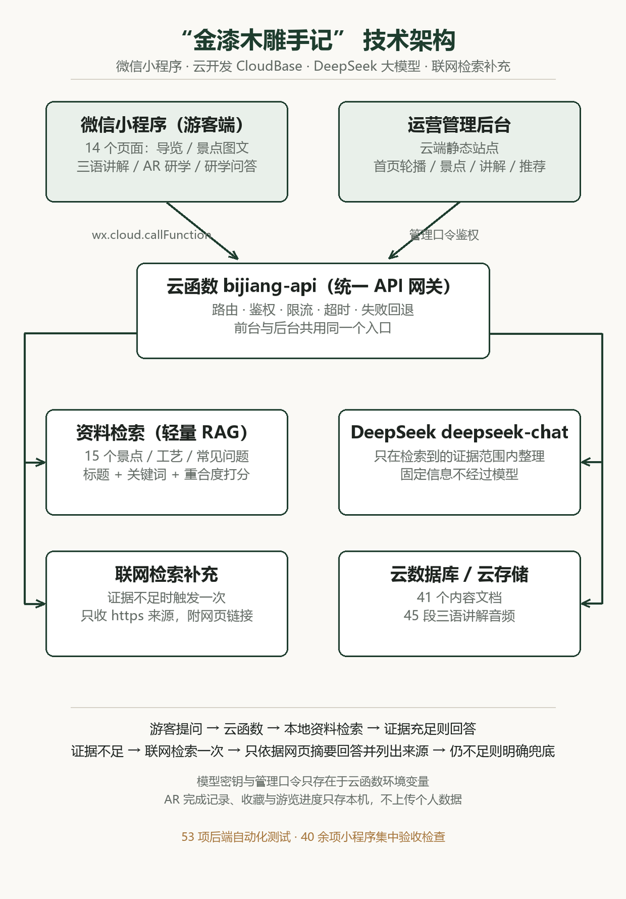

| 层 | 技术 |
|---|---|
| 客户端 | 原生微信小程序（14 页）、camera 组件、wx.cloud.callFunction、本机存储 |
| 云开发 | 云函数 `bijiang-api`（Node.js 16，17 条路由）、云数据库（41 个内容文档）、云存储（45 段音频） |
| AI | DeepSeek `deepseek-chat`、规则检索、`/v1/tools/search` 联网检索 |
| 后台 | CloudBase 静态托管 ＋ 云函数口令鉴权 |
| 质量 | `node:test` 53 项、集中验收脚本 40 余项静态检查 |

几个实现细节：

- **统一请求层**：普通接口缓存命中后 1.5 秒回退，问答接口单独放宽到 35 秒（宁可出旧缓存，也不让页面卡住）。
- **单一云函数网关**：前台与后台共用同一个入口，按 `path + method` 分发，管理口令换取会话。
- **音频发布校验**：45 段讲解上传后逐条下载回算 SHA-256，45/45 一致才写入云数据库并标记可播放。
- **可撤销的后台修改**：替换景点封面时记录上一张，可预览并恢复。
- **包体控制**：14 页、113 个文件、约 1.91 MiB，超 200 KB 单资源 0 个。

## 素材与授权

| 素材 | 来源 |
|---|---|
| 景点照片、首页轮播、AR 目标影像 | 项目组在碧江金楼**现场实拍** |
| 导览地图 | 与景区对接后取得的**景区实际导览图** |
| 三条推荐游线 | **景区工作人员提供**的实际游览路线 |
| 历史文化结论 | 对照博物馆与高校公开页面核对，仅用于事实核对，不使用其图片 |
| 讲解文本 | 项目自行整理；粤语、英语为机器翻译试听稿，正式发布前仍需景区审稿 |

以上素材仅用于本参赛作品与教学演示，不转售、不再授权第三方。

## 商业与边界

- **服务页可运营**：周边推荐位可上架附近景点、酒店、美食与商铺，形成可收费的展示与导流位；当前为示意内容，不虚构营业信息、评分或价格。
- **不做资金处理**：购票只跳转景区官方入口，小程序不处理支付、订单、退款与票据。
- **不采集个人信息**：收藏、游览记录与 AR 完成记录只存本机；运营统计为匿名事件计数。
- **不宣称做不到的事**：不称自动识别木雕、空间锚定、三维重建、向量检索或多智能体编排。
- **与景区合作**：项目组已与景区工作人员沟通并开展合作，先以个人主体版本试点上线，目前已进入交付范围与价格的洽谈阶段；产品本身不代表景区官方运营主体，企业版交付后由景区主体承接对外运营。

## 后续规划

| 阶段 | 内容 | 状态 |
|---|---|---|
| 个人版交付 | 与景区就交付范围、内容清单与价格达成一致，完成首次交付 | 洽谈中 |
| 转企业版 | 交付成功后改为企业主体，由景区或企业资质承接对外运营 | 已规划 |
| 接入购票支付 | 企业版内接入支付、订单、退改与对账，替代当前"跳转官方购票入口"的过渡方案 | 已规划 |
| AR 与内容扩展 | 扩展到更多木雕目标与工艺图解；取得授权目标图后评估真实图像锁定 | 持续 |
| 讲解升级 | 粤语、英语由机器翻译试听稿改为人工录制 | 持续 |
| 运营体系 | 周边商家上架流程、结算方式与内容看板，支撑服务页广告位收费 | 已规划 |

## 快速开始

```powershell
# 后端（Express + SQLite）
cd backend
npm.cmd install
npm.cmd test        # 53 项自动化测试
npm.cmd start       # http://127.0.0.1:3000/api/v1
```

微信开发者工具导入 `frontend/`；开发阶段可关闭"不校验合法域名"。API 地址集中在 `frontend/miniprogram/config.js`：真机联调填运行后端电脑的 WLAN IPv4 地址。

云函数 `frontend/cloudfunctions/bijiang-api` 需绑定自备云开发环境，并在环境变量中配置 `DEEPSEEK_API_KEY`（不提供密钥）。

## 目录结构

```
frontend/
  miniprogram/           原生小程序：14 个页面、组件与请求层
  cloudfunctions/        云函数 bijiang-api：路由、AI 问答、管理接口
  admin-web/             运营管理后台（云端静态站点源码）
backend/                 Express API、数据库脚本、自动化测试与验收脚本
docs/                    AI 问答说明、AR 前端契约与真机验收清单
docs/screenshots/        README 配图（现场实拍与真实运行界面）
```

## 相关文档

- [`docs/AI_KNOWLEDGE_ASSISTANT.md`](docs/AI_KNOWLEDGE_ASSISTANT.md)：AI 问答链路、检索与回退说明
- [`docs/AR_FRONTEND_CONTRACT.md`](docs/AR_FRONTEND_CONTRACT.md)：AR 页面状态与事件契约
- [`docs/AR_DEVICE_ACCEPTANCE_AND_DEMO.md`](docs/AR_DEVICE_ACCEPTANCE_AND_DEMO.md)：真机验收清单与演示脚本
- [`docs/STUDY_KNOWLEDGE_QA.md`](docs/STUDY_KNOWLEDGE_QA.md)：知识来源与审核状态
- [`CONTRIBUTING.md`](CONTRIBUTING.md)：协作与提交规范

## 接口一览（本地后端）

```
GET  /api/v1/health
GET  /api/v1/home
GET  /api/v1/spots
GET  /api/v1/spots/:id
GET  /api/v1/spots/:id/narrations
GET  /api/v1/spots/:id/craft-guide
GET  /api/v1/site-map
GET  /api/v1/panoramas
GET  /api/v1/panoramas/:id
GET  /api/v1/service
GET  /api/v1/routes
GET  /api/v1/recommendations?category=food|hotel|transport|attraction
GET  /api/v1/assistant/suggestions
POST /api/v1/assistant/chat
```

## 数据备份与内容修改

在 `backend` 目录运行：

```powershell
npm.cmd run backup                       # 备份到 data/backups/，带完整性校验
npm.cmd run restore -- "data/backups/文件名.db" --confirm
npm.cmd run content:update -- --id jinlou --summary "经审核的正式简介"
```

备份与恢复都会校验文件完整性；恢复前必须停止后端服务，缺少 `--confirm` 时命令会拒绝执行。密钥、管理口令、数据库、本机配置与用户数据不得提交到仓库。

---

© 2026 金漆木雕手记团队 · 本仓库用于比赛提交与教学演示，能力描述与实际代码一致。
